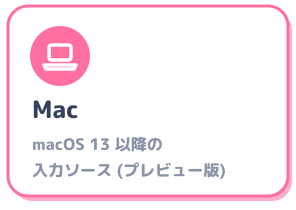

  

<b>雪解けのように、半角/全角の壁を溶かす日本語入力。</b>

  
  
  

  <a href="https://github.com/yksr-melt/Meltype/releases/latest"><b>ダウンロード</b></a>
  &nbsp;·&nbsp;
  <a href="USAGE.md">使い方</a>
  &nbsp;·&nbsp;
  <a href="../README.md">トップの README</a>
  &nbsp;·&nbsp;
  <a href="https://github.com/yksr-melt/Meltype/issues/new/choose">不具合の報告・提案</a>

  
  
  

半角/全角 キーを押さなくても、日本語と英語を打ち分けられるようにする Windows 用の日本語入力です。
ローマ字で打つだけで、日本語か英語かを Meltype が見分けて、その場で切り替えます！

 

 

- Windows 10 / 11 (64bit)
- Microsoft IME (Windows 標準の日本語入力)

.NET は同梱しているので、別にインストールする必要はありません。

 

 

1. [Releases](https://github.com/yksr-melt/Meltype/releases/latest) から `Meltype-<version>-setup.exe` をダウンロード
2. 開いて、案内どおりに進める
3. タスクトレイに「あ」のアイコンが出たら準備完了！ Windows の起動時にも自動で起動します

管理者として実行する必要はありません。新しい版は自動で入ります。

- 「Windows によって PC が保護されました」と出たら、「詳細情報」→「実行」。コード署名をしていないため表示されます
- zip 版は `Meltype-<version>-windows.zip` を展開して `Install.cmd` をダブルクリックします。インストーラーでも zip でも、入る場所は同じ `%LOCALAPPDATA%\Programs\Meltype` です
- 「Meltype を終了できませんでした」と出たら、タスクトレイの Meltype のアイコンを右クリック →「終了」してから、もう一度インストールしてください (前に管理者として実行したことがあるときに出ます)

インストールの途中で「Meltype IME を Windows に登録します」と出て、管理者権限の確認が出ます。
「はい」を選ぶと、打った文字が入力欄にそのまま下線付きで入り、変換の候補は入力位置の下に一覧で出るようになります。

- <kbd>Win</kbd> + <kbd>Space</kbd> で「Meltype」を選んで使います
- アイコンを右クリック →「Meltype キーボード (変換ボックスで入力)」を選ぶと、変換ボックスで入力する方式に戻せます
- 「いいえ」を選んでも、変換ボックスで入力する方式 (Meltype キーボード) で使えます。もう一度インストールすると、また聞きます

SmartScreen の警告とは別のものです。誤検知のこともありますが、検出名だけでは見分けられません。

1. Windows セキュリティ →「ウイルスと脅威の防止」→「保護の更新」で定義を新しくする
2. 公式のリリースからダウンロードし直して、もう一度検査する
3. それでも検出されるときは、保護を切ったりフォルダーを除外したりせずに、「保護の履歴」で検出名を確かめて [Issues](https://github.com/yksr-melt/Meltype/issues) で教えてください (個人名・パス・ダウンロード URL の一時トークンは隠してください)

 

 

メモ帳やブラウザの入力欄で、IME を気にせずそのままローマ字で打つだけ！
日本語はかなで、英単語 (google, hello など) は英字のまま出ます。

| キー | |
|---|---|
| <kbd>Enter</kbd> | 確定 |
| <kbd>Space</kbd> / <kbd>↓</kbd> | 漢字に変換・候補を切り替える (英単語のときは確定して空白) |
| <kbd>←</kbd> <kbd>→</kbd> | 文節を選ぶ (<kbd>Shift</kbd> + <kbd>←</kbd> <kbd>→</kbd> で区切りを変える) |
| <kbd>BackSpace</kbd> / <kbd>Esc</kbd> | 1 音ずつ消す / 取り消す |
| <kbd>F7</kbd> / <kbd>F10</kbd> | カタカナ / 英字 |
| <kbd>Tab</kbd> | 「もしかして: ブレスレット (Tab)」のような書き間違いの直しを受け入れる |
| <kbd>半角/全角</kbd> | 英数 (そのまま入力) と日本語の切り替え |
| <kbd>Ctrl</kbd> + <kbd>半角/全角</kbd> | Meltype 自体の有効 / 無効 (トレイのアイコンのダブルクリックでも同じ) |

- よく使う言葉は、アイコンを右クリック →「ユーザー辞書...」で登録できます
- ！ ？ ～ は <kbd>Shift</kbd> を押して打つと全角 (英文の後は半角)。<kbd>Shift</kbd> を押して打った大文字で始まる語 (Google, W など) は英語
- 小書き文字は x / l (xa, la = ぁ、ltu = っ)
- 変換して候補を切り替えると、絵文字・顔文字も出ます (えがお → 😊、かおもじ → (^^) など)
- VS Code やターミナルでは基本は英数のままで、コメント (// や #) と "…" の中だけ日本語になります。コードの行で <kbd>半角/全角</kbd> を押すと、その行だけ日本語で打てます (VS Code のチャット欄や Claude Code など AI への入力は、日本語が基本のままです)
- 英語とも日本語とも読める語 (api など) は、<kbd>F10</kbd> で英字にするか、Space を連打して候補の最後の英字を選んで確定すると、次から英字になります (<kbd>F6</kbd> でかなにすると次からかな)

もっと詳しい使い方は [USAGE.md](USAGE.md) にあります。

タスクバーの Windows の IME の表示は、Meltype が動いている間は常に「A」になります (故障ではありません)。Meltype が Windows の IME を OFF にして、代わりに入力を受け持っているためです。
今のモードは、次のどちらかで確かめてください。

- 入力欄をクリックしたときと <kbd>半角/全角</kbd> を押したとき、カーソルの近くに「あ」(日本語) か「A」(英数) が一瞬出ます
- タスクトレイの Meltype のアイコン (日本語は「あ」、英数は「A」)。Windows 10 では最初「^」の中に隠れていることがあるので、ドラッグしてタスクバーに出しておくと便利です

タスクバーの IME の「A」が紛らわしい場合は、Windows の設定で非表示にできます (Windows 10: 設定 → 個人用設定 → タスクバー → システム アイコンのオン/オフ →「入力インジケーター」をオフ)。Meltype を使わないときに IME の状態が見えなくなるので、お好みで。

アイコンを右クリック →「自動判定の強さ」で選べます (設定画面の「判定」でも同じ)。

| 強さ | |
|---|---|
| 積極的 | 英語らしければすぐ英字にする |
| 標準 | 既定。no / to / ga のような短い語は、前後が英語 (英文の途中) のときだけ英字 |
| 慎重 | 確信度が高いときだけ英字にする |
| 手動 | 自動では英字にしない。変換ボックスの下に「Tab → google (英字に)」と提案が出るので、<kbd>Tab</kbd> で英字にする |

英単語の判定には、同梱の辞書に加えて Windows の英語スペルチェッカーを使います。

設定の「入力方式」を「かな入力 (JIS)」にすると、JIS かな配列で入力できます (Shift+E = ぃ、Shift+Z = っ、Shift + ね = 、)。打ったキーの英字が英単語 (google など) なら英字で見せます。自動判定の強さもローマ字入力と同じように効きます。

Meltype が有効な間は、Windows の IME (Microsoft IME・Google 日本語入力) を自動で OFF にします。
ほかの IME を使いたいときは <kbd>Ctrl</kbd> + <kbd>半角/全角</kbd> で Meltype を一時停止してください。

 

 

タスクトレイのアイコンを右クリック →「不具合の報告・提案...」から報告できます。次の 3 つを書いてもらえると助かります！

1. どのアプリで (メモ帳 / Chrome / Discord など)
2. 何と打って (例: `kyouhagoogle` と打って Enter)
3. どうなったか (例: 「今日はごおｇぇ」になった)

あわせて、右クリック →「ログ / 判定理由...」→「コピー」で、ログを貼り付けてもらえるとさらに助かります。ログには直前に打った文字の一部が含まれるので、気になる部分は消してから送ってください。

 

 

設定と学習データは `%LOCALAPPDATA%\Meltype` に保存されます。打った内容をネットワークに送ることはありません。
通信するのは、新しい版があるかを GitHub に確かめるときだけです (アイコンを右クリック →「更新」→「自動で更新する」で止められます)。

 

 

タスクトレイの Meltype のアイコンを右クリック →「アンインストール...」を選びます。
Windows の「設定」→「アプリ」→「インストールされているアプリ」で Meltype の「…」→「アンインストール」でも同じです。

- インストーラーで入れた場合は、最後に設定と学習データも消すかを聞かれます
- zip 版は、展開したフォルダーの `Uninstall.cmd` でも消せます。こちらは停止・自動起動の解除・設定と学習データの削除までまとめて行います

 

 

- Windows 版の本体は `src/Meltype` (WinForms のアプリ)、Meltype IME は `native/` にあります
- ビルド・テスト・仕組み → [DEVELOPMENT.md](DEVELOPMENT.md)、Meltype IME の仕組み → [TSF_DESIGN.md](TSF_DESIGN.md)、リリースの手順 → [RELEASE.md](RELEASE.md)

Meltype は GNU GPL v3 ([LICENSE](../LICENSE)) で配布しています。同梱の .NET ランタイムは MIT ライセンスです ([THIRD-PARTY-NOTICES.md](../THIRD-PARTY-NOTICES.md))。
