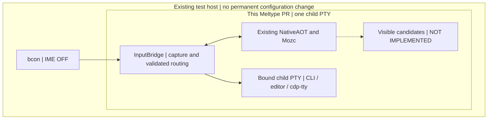

# Direct TTY — real-native transport; visual acceptance still open

Goal: bcon IME OFF → existing Meltype NativeAOT/Mozc → one bound child PTY,
without Fcitx5, IBus, SKK, a new language detector, or a resources change.
**Draft / PRODUCT_NOT_READY / BCON_NOT_PROVEN.** This is not yet usable as a
replacement IME: candidate data exists but its terminal overlay is not implemented.

## Implemented boundary

The Core/Windows/IBus sources remain unchanged. A startup pipe prevents child
exec until NativeAOT initialization and TTY setup succeed; NativeAOT is still
initialized only after fork. Paste cannot overtake pending composition. Cursor,
device and graphics replies are opaque, not a request to commit input. Candidate
arrows and F6–F10 go to the existing Core while composing. Escape uses an elapsed
key deadline independent of child output. Invalid Unicode and unsupported edits
fail before writing. Cleanup restores the terminal and bounds the owned-child wait.

The original 13 controlled tests remain, with 14 regression tests added. The
separate real-native test uses the actual built library and Mozc helper through
real POSIX PTYs for eight fixed cases. Each runs in a fresh process and temporary
HOME/XDG directories: Core path caching and candidate learning must not contaminate
another case. Missing real artifacts fail rather than silently selecting a stub.
These tests do not establish real bcon display or physical-key acceptance.

## Same-build delivery and checks

linux/build.sh now includes tty/*.py, this README and tty/tests/*.py in the same
Meltype-linux package as libMeltypeNative.so and mozc/meltype_mozc_helper.
The existing Linux workflow runs the controlled suite before build, then the
packaged controlled suite and packaged real-native test before upload. Each native
result records hashes of the wrapper, NativeAOT library and Mozc helper.
The TTY entry is not installed as a service and does not change OS configuration.

The experimental script takes --native, --mozc and -- followed by a child command.
Use only a disposable PTY; do not wrap valuable long-running work. An unsupported
or unknown effect ends this experimental transport rather than replaying input.

## Remaining implementation and acceptance

- Visible preedit/candidate overlay, safe redraw/resize and bcon Kitty coexistence.
  Compare the existing ttyskk terminal frontend before choosing a new display path.
- Safe deferred-input/target-edit contract for native deleteBefore requests.
  Rejecting these is a safety boundary, not completed reconversion or native Undo.
- Linux typed Proposal connection: original ID/type, generation, cancellation and
  at-most-once selection; no second ranker or data authority.
- Full extended Kitty keys, application input-mode boundaries, wide Unicode events,
  focus/VT changes, terminal recovery and supported multiline editing.
- Real bcon at a pinned revision on an isolated NixOS VT with IME OFF: actual input,
  preedit, candidate selection/cancellation, fixed-PTY effects and negative tests.
- Existing cdp-tty child → same existing Headless Chrome target: Japanese DOM
  readback, not merely PTY byte emission; unknown effects are not blindly retried.
- Independent same-version source/build/artifact/host review. Self-check is not R.

The real bcon proof belongs to this Meltype PR. No new resources PR is needed for
initial implementation/proof. Permanent NixOS installation, distribution and
recovery declarations belong to resources only when actually changed later.

Design: https://github.com/roccho-dev/adrs/issues/618
Browser ownership: https://github.com/roccho-dev/adrs/issues/615
No merge, deployment, secret/profile change or old-edits retirement is claimed.
