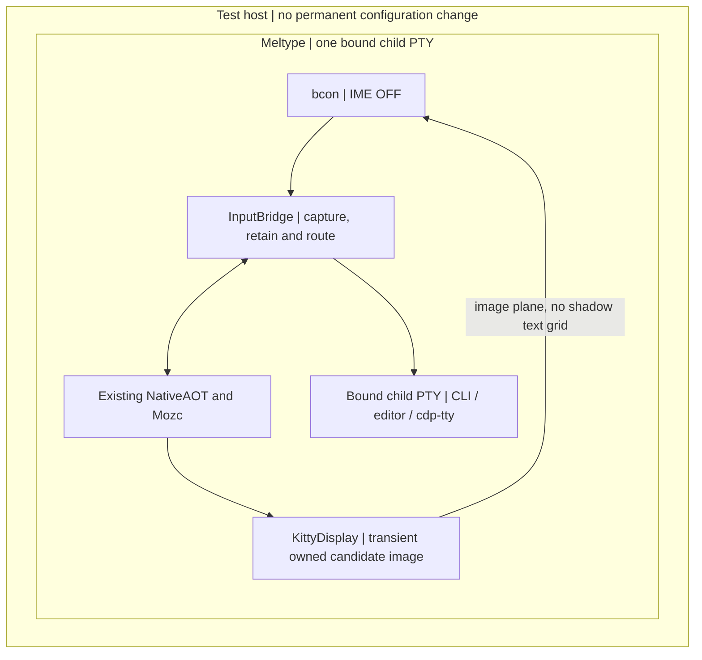

# Direct TTY — existing Meltype Core, per-PTY input and Kitty candidate images

Goal: bcon IME OFF → existing Meltype NativeAOT/Mozc → one bound child PTY,
without Fcitx5, IBus, SKK, a second language detector or a resources change.
**Draft / PRODUCT_NOT_READY.** The implemented candidate-image path must pass
actual bcon scanout acceptance; protocol/PNG tests alone are not that evidence.

## Implementation

The conversion algorithm and Windows/IBus entry points are unchanged. The session
adds only attachment to its existing Proposal port and a view-only snapshot. NativeAOT initializes after fork;
a startup pipe holds child exec until native, font and graphics-capability checks
succeed. An unsupported terminal does not silently run invisible composition.
Paste cannot overtake pending composition. Cursor/device/graphics replies are
opaque, not a request to commit. Native candidate arrows and F6–F10 work during
composition. Kitty CSI-u/modifyOtherKeys use the same Core; consumed key releases
are suppressed, and unconsumed protocol bytes survive unchanged. Escape timing is
independent of child output. Cleanup restores the terminal and reaps its own child.

The Kitty display uses an existing CJK font with Pillow. It requests the actual
cursor in serial order, pauses user input until that report is received, and does
not forward later child output while its own query is pending. A finite boundary
parser prevents insertion inside UTF-8/control/image sequences. Only one owned
image is deleted; child cells, saved cursor slots and a full shadow grid are not
owned or copied. Origin-relative cursor mode currently fails explicitly.

This is the bcon-specific alternative to copying ttyskk's SKK-coupled frontend:
reuse bcon's graphics plane rather than maintain another terminal screen model.
It is not a claim of universal VT/terminal compatibility or independently accepted
optimality. A concrete failed case can require revisiting the choice.

## Same-build checks and delivery

linux/build.sh includes tty source/tests with the same NativeAOT library and Mozc
helper. The existing workflow requires controlled regression tests, nine real
Core/Mozc/bound-PTY cases, a real CLI/native/PTY/PNG transport test, and six real
NativeAOT typed-Proposal cases before ZIP upload. Real-native cases use fresh processes and temporary HOME/XDG paths so
learning/path caches cannot contaminate another case. Missing real artifacts fail.
The CLI test records hashes and checks candidate images, selected child text, exit
status and restored termios. Its terminal replies are controlled, not actual bcon.

The additional standard NixOS VM test reuses the existing pinned resources bcon
package read-only. It runs unchanged bcon on a real VM VT, sends virtual physical
keys, takes QEMU scanout PNGs, reads actual child bytes and checks terminal recovery.
Nix packaging adjusts ELF paths using standard autoPatchelfHook; this runtime
adaptation is not called byte-identical to the Ubuntu artifact. No production
configuration, credentials, browser profile, source or resources PR is changed.

For disposable trials, the script takes --native, --mozc, --font and -- followed by
the child command. Python 3, Pillow and an existing CJK font are runtime dependencies.
No fonts are copied into the product. --transport-proof explicitly allows nonvisual
transport tests only. Do not use the experimental entry around valuable work.

## Optional typed Proposal connection

MELTYPE_PROPOSAL_URL explicitly enables the existing local HTTP provider contract:
request generation/raw; response generation/raw/proposals with original id,
representation, typed meaning and evidence. Without that variable, this path
makes no network request and the conversion behavior is unchanged. Captured input
is sent to the configured local provider only when enabled. No credentials,
redirects, environment proxy or nonlocal endpoint are used by this transport.

HTTP runs outside the key thread with one inflight request, one replaceable pending
request and one result. All native callbacks run back on the input thread. The
existing Core owns candidate generation, cancel, ABA and one-time selection; no
second ranker is added. The native port retains the original typed selection,
available through take_selection; it is a selection, not a downstream effect receipt.

The native port binds a query to the fixed child PTY and its target epoch. Unknown
or changed targets, including a target changed away and back, refuse selection.
This does not turn a PTY token into proof of a browser/GUI caret; applications that
change invisible fields require their own observed edit capability. Control-bearing
candidate text is refused rather than executed as a terminal command. Native
Undo, arbitrary multiline edits and deletion of already committed text are not
claimed by this restricted transport.

## Verified milestone and scope

At d610408, Linux CI 38239972011 passed the actual bcon NixOS VM candidate
scanout, selection, child text, same-phase terminal restoration, and unchanged
cdp-tty attachment to a test-owned existing Chrome target. Japanese DOM text,
viewer exit and retained browser PID/target were read back. The production user
browser and physical laptop were not used. Later source changes require their own
same-head checks; this milestone is not transferred by assertion.

## Remaining acceptance

- Actual bcon pipeline result and visual review; a configured job is not a PASS.
- Safe native deleteBefore/reconversion and supported multiline editing: still
  rejected, not emulated with unverified shell backspaces. Native Undo unproven.
- Same-build native/HTTP Proposal tests and independent integration review of the
  configured real provider; fixed-PTY identity is not universal caret identity.
- App mode/focus/VT changes and extended-key edge cases beyond the fixed tests.
- Preserve the bcon → existing cdp-tty → existing test Chrome DOM proof on each head.
- Independent same-version review; self-checks are not an independent R.

Initial implementation and bcon evidence stay in this Meltype PR. resources owns
later permanent NixOS installation/distribution/recovery changes only if needed.
Design: https://github.com/roccho-dev/adrs/issues/618
Browser ownership: https://github.com/roccho-dev/adrs/issues/615
No merge, deployment, secret/profile change or old-edits retirement is claimed.
