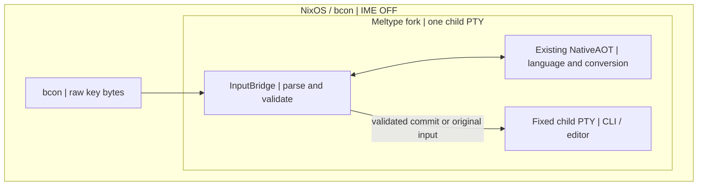

# Direct TTY: transport proof (Draft)

Goal: run the **existing** Meltype NativeAOT session inside one child PTY without
Fcitx5, IBus, SKK, or a new language detector. This is a bounded **experimental
transport**, not a production IME and not a replacement for the existing IBus path.

## Current proof

- Builds on the already merged Meltype PR #1 **via main**, without changing
  the shared C# Core or the Windows/IBus entry points.
- Uses the existing meltype_handle_key / meltype_commit NativeAOT C ABI.
- Does not initialize NativeAOT until **after** the child fork; the runtime is
  never inherited by the child. Each invocation owns precisely one child PTY.
- Stops before output for invalid results, deleteBefore edits, unconfirmed
  control characters, or incomplete input sequences. Bracketed paste is bounded
  and only emitted after the entire closing marker has been seen.
- No background daemon, separate ranker, model, database, SKK engine or Fcitx5.
- Tests include real POSIX PTY isolation and a C-ABI test shim. These tests do
  **not** establish real Meltype conversion quality or NixOS/bcon E2E.

## Trial entry (disposable host only)

Run the existing Python 3 script with --native pointing to the actual
libMeltypeNative.so, --mozc to the same build's meltype_mozc_helper,
and -- followed by the child command. Both must come from the same pinned
Linux build, and stdin/stdout must be a physical TTY.

It is deliberately not installed by linux/build.sh and not a NixOS service.

## NOT DONE

- **No preedit or candidate overlay.** Meltype's view is kept away from the
  child's stdin, but is not yet displayed. This is not a usable replacement IME.
- Meltype may request deleteBefore after sending earlier ASCII. The proof
  rejects that request rather than synthesizing unverified shell backspaces.
  A safe deferred-input or proven target-edit contract is required.
- No typed Proposal port on Linux NativeAOT; no old-ID/ABA proof.
- Extended Kitty keys, wide Unicode input events, shell mode boundaries,
  output overlays, native Undo and cdp-tty are not proven.
- No exact native build + actual bcon TTY + restart/readback combination yet.

Design: [ADRS #618](https://github.com/roccho-dev/adrs/issues/618).
Browser ownership: [ADRS #615](https://github.com/roccho-dev/adrs/issues/615).
This draft does not authorize deployment, merge, or retiring edits.

## bcon / NixOS E2E ownership (in this Meltype PR)

**The real bcon proof belongs to this Meltype PR, not to a new resources PR.**
Run the test on an isolated NixOS VT with an already available pinned bcon
build, terminal.ime=false, no Fcitx5 input path and a pinned matching
Meltype NativeAOT + Mozc helper. Neither this PR nor the test may mutate
resources, persistent browser profiles, system configuration or user secrets.

Completion requires separately recorded **actual** observations with source
revision, bcon revision, host/VT identity, input, expected output, actual child
PTY bytes, display evidence, and readback:

1. Direct ASCII and shell controls reach only the bound child PTY, byte-exact;
   no Japanese misclassification, silent key loss or unexpected command execution.
2. Mixed English/Japanese can be composed and corrected with the original
   Meltype core, visible preedit and candidate selection; neither SKK nor
   Fcitx5 is required. The current code **does not yet pass** this gate.
3. Resize, PTY output repaint, Ctrl/Alt/Escape/Enter, paste, focus/VT switch,
   app exit and restart preserve the terminal and never replay an uncertain
   write. Unobservable target state must fail closed.
4. With cdp-tty as the child, a committed Japanese string actually reaches
   the *existing* Headless Chrome target and is independently read back;
   byte emission to PTY alone is not proof of browser effect.
5. Real code, built artifact, test invocation, rollback and independent
   review refer to the same revision; a CI stub/PTY test cannot be promoted
   to bcon real-input acceptance.

Until those gates pass, **BCON_E2E=NOT_PROVEN / PRODUCT=NOT_READY**.
A resources PR is warranted only when making a permanent NixOS declaration,
distribution or recovery change, after the product implementation is accepted.
